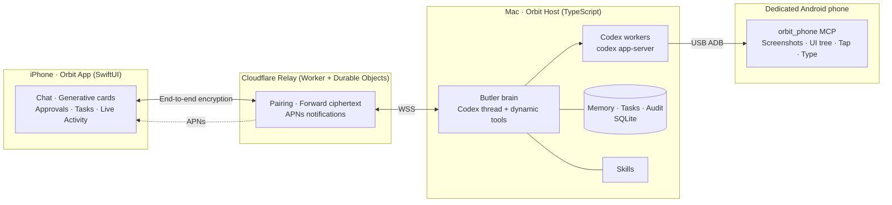

<div align="center">


# Orbit

**English** | [简体中文](README.zh-CN.md)

A personal butler that lives on your Mac: Codex is the brain, a dedicated Android phone is the hands, and your iPhone is the face.


</div>

> [!WARNING]
> **This is an experimental project and real-world use is likely to fall short of your expectations.**
> The project was largely built through vibe coding and has plenty of bugs. It is suitable for exploration and experimentation, but should not be trusted with important tasks.

<p align="center">
  
</p>

## What is Orbit?

Orbit is a self-hosted personal butler made up of four parts:

- **Brain:** Runs on your Mac and is powered by OpenAI Codex.
- **Hands:** A dedicated Android phone controlled over USB ADB to order food, check deliveries, book tickets, and compare prices.
- **Face:** The Orbit app on your iPhone, where you chat, receive notifications, and approve requests.
- **Relay:** A Cloudflare relay that only forwards encrypted messages.

Orbit is not a one-question-at-a-time chatbot. It remembers things over time, periodically checks what may need attention, and decides whether an important phone notification is worth bringing to you. It only interrupts you when a decision needs your input.

## Features

### Built on Codex's mature agent infrastructure

- The **brain** is a long-running Codex thread (`codex app-server` JSON-RPC). Butler capabilities are exposed as dynamic tools for tasks, memory, notifications, approvals, generative cards, and more.
- **Complex tasks** are delegated to independent Codex worker sessions for research, coding, computer use, or phone use. They can run in parallel, be interrupted or cancelled, and leave audit records.
- **Billing** uses your own Codex (ChatGPT) quota; no separate API key is required.
- **Skills** are Markdown files under `skills/` that describe behavior, Codex orchestration, generative UI, domestic service discovery, memory rules, and phone operation. Editing a file can change how the butler works.

### Proactive, not just reactive

- **Heartbeat:** The butler wakes on a schedule to check your calendar, to-dos, and active tasks, and speaks only when there is something to report. You can set a separate model and reasoning effort for the heartbeat.
- **Phone notification wake-up:** When the dedicated phone receives a notification, the butler reviews it and decides whether and how to tell you. It ignores ads and noisy group chats and never repeats verification codes.
- **Tiered APNs notifications:** Four levels—record only, silent, ordinary, and time-sensitive—with a daily notification budget and quiet hours to avoid dozens of interruptions a day.
- **Live Activity:** Shows active task progress on the Lock Screen and Dynamic Island.

### More human

- **Long-term memory:** Clear rules guide what to remember and prevent indiscriminate storage.
- **Dynamic context:** The conversation context is compacted automatically while idle, but not during task execution, so long-term use does not keep getting slower or more expensive.
- **Natural language:** The interface does not show technical details such as “calling tool X”; while waiting, it shows only a restrained typing animation.
- **Generative cards:** Places, links, images, and task progress appear as cards instead of a wall of text.
- **Knows its limits:**
  - Queries are read-only by default. Payment requires your explicit authorization.
  - You handle sign-ins, verification codes, QR scans, and face recognition.
  - Sensitive actions require approval on the iPhone.
  - Tasks can be interrupted at any time.
- **Understands life in China:** Includes methods for using common services such as Meituan, Taobao, JD.com, 12306, and Amap. WeChat is unavailable on the dedicated phone, so the butler looks for another route or hands the task back to you when none is available.

### Privacy and security

- **End-to-end encryption:** iPhone and Mac messages use X25519, HKDF, and ChaCha20-Poly1305. Pairing verifies a short SAS code; the relay sees only ciphertext.
- **Host identity:** Authenticated with Ed25519. The relay can enforce an allowlist (`ALLOWED_HOST_IDS`).
- **On the phone:** Password pages in screenshots are identified as sensitive, input values in the UI tree are redacted, and final evidence screenshots are stored locally.

## Screenshots

<table>
  <tr>
    <td></td>
    <td></td>
    <td></td>
  </tr>
  <tr>
    <td></td>
    <td></td>
    <td></td>
  </tr>
</table>

## Architecture



| Directory | Contents |
|---|---|
| [`host/`](host/README.md) | Mac Host (TypeScript / Node): butler brain, Codex orchestration, tasks, memory, heartbeat, notifications, and phone tasks |
| [`relay/`](relay/README.md) | Cloudflare Worker + Durable Objects: Host authentication, device pairing, ciphertext forwarding, and APNs |
| [`ios/`](ios/) | iPhone client (SwiftUI, project generated by xcodegen): chat, generative cards, approvals, Live Activity, and widgets |
| [`phone/`](phone/) | `orbit_phone`: Android automation MCP service (Python), 0–999 coordinates, screenshots, UI tree, ADB Keyboard input, device lock, and evidence |
| [`skills/`](skills/README.md) | Butler skills: behavior rules, Codex orchestration, generative UI, domestic services, memory, and phone operation |
| [`docs/`](docs/) | End-to-end encryption protocol, design documents, and screenshots |

## Deployment

### What you need

| Item | Details |
|---|---|
| Mac | macOS, Node.js ≥ 22.13, Python ≥ 3.11, and [uv](https://docs.astral.sh/uv/) |
| Codex | Install [Codex CLI](https://github.com/openai/codex) and sign in with a ChatGPT account (`codex login`) |
| Cloudflare account | For deploying the relay; Workers and Durable Objects are required |
| iPhone | iOS 18+, and a Mac with Xcode and [xcodegen](https://github.com/yonaskolb/XcodeGen) |
| Dedicated Android phone | Android 11+, USB debugging enabled, [ADB Keyboard](https://github.com/senzhk/ADBKeyBoard) installed, and adb (platform-tools) on the Mac. Xiaomi / HyperOS also requires “USB debugging (Security settings)” |
| Apple Developer account (optional) | Required for push notifications. Without one, you can self-sign with a free account, but the app expires after 7 days and cannot receive push notifications |

### 0. Get the code

```bash
git clone https://github.com/HerrysYu/orbit.git
cd orbit
```

### 1. Deploy the relay

```bash
cd relay
npm install
npx wrangler login
npx wrangler deploy        # note the https://<name>.<subdomain>.workers.dev URL printed by the command
```

- Open `relay/wrangler.toml` and set `ALLOWED_HOST_IDS` to your Host's hostId, or leave it empty for no restriction. Redeploy after changing it.
- Push notifications require an APNs key. In the Apple Developer portal, create a **Key** with APNs enabled and download the `.p8` file. You need the `.p8` key, not a `.cer` certificate. Then run:
  ```bash
  npx wrangler secret put APNS_KEY_P8    # paste the full contents of the .p8 file
  npx wrangler secret put APNS_KEY_ID    # 10-character Key ID
  npx wrangler secret put APNS_TEAM_ID   # 10-character Team ID
  ```
- See [relay/README.md](relay/README.md) for details and troubleshooting.

### 2. Start the Mac Host

```bash
cd host
npm install
npx tsx src/cli.ts config relay wss://<your-worker>.workers.dev
npx tsx src/cli.ts install-skills     # install the skills in skills/
npx tsx src/cli.ts start              # start the butler
npx tsx src/cli.ts launchd            # optional: create a LaunchAgent that starts at login
```

### 3. Prepare the dedicated Android phone

1. Connect the phone to the Mac over USB and trust this computer on the phone.
2. Run:
   ```bash
   cd host
   npx tsx src/cli.ts phone setup        # run uv sync under ../phone
   npx tsx src/cli.ts phone status       # check ADB device, keyboard, and security debugging settings
   ```
3. By default, Orbit operates one phone. If multiple phones are connected, set `OPA_PHONE_SERIAL` to select a serial number.

See [host/README.md](host/README.md) for more options.

The Host also includes an MCP directory for Amap, 12306, Feishu, Playwright, web fetching, Tavily, GitHub, and Notion. Services are loaded per task. Run `opa mcp list` to view their status and `opa mcp init` to create local configuration; enter credentials separately for services that require keys. See [Services and ModelScope import](docs/mcp-services.md).

Gmail, Notion, Google Calendar, and Google Drive can use plugins already connected to Codex; Google Docs is provided through Drive's document tools. The butler first checks the available interfaces and permissions. It prefers service MCPs or plugins when they cover a step, then considers a website, and uses a computer or phone interface only when needed.

Choose **「清除聊天记录」(Clear chat history)** from the menu in the upper-right corner of the App chat page. After confirmation, it clears the chat and resets the current conversation; long-term memory, tasks, and pairing information are retained. This feature requires an updated Host and App.

### 4. Install the iPhone client (self-signing)

```bash
brew install xcodegen
cd ios
xcodegen generate
open OPA.xcodeproj
```

- First edit `ios/project.yml`: set `DEVELOPMENT_TEAM` to your Team ID and `APP_BUNDLE_ID` to your Bundle ID, then run `xcodegen generate` again.
- In Xcode, select your iPhone and click Run. The first time, trust the developer on the phone under Settings → General → VPN & Device Management.
- Push notifications use the App's Bundle ID as the APNs topic and require a paid Apple Developer account.

### 5. Pair

```bash
cd host
npx tsx src/cli.ts pair       # displays a QR code in the terminal
```

Scan it with Orbit on the iPhone. Confirm only after the SAS codes shown on both devices match. You can then chat with the butler in the App. You can also run `npx tsx src/cli.ts chat` to chat directly in the terminal.

## Limitations

To be candid, Orbit still has many limitations:

- **Platforms:**
  - The computer-side Host supports macOS only.
  - The dedicated phone supports Android only.
  - The client is available for iOS only.
- **Live Activity** still has bugs, and its status may occasionally become unsynchronized.
- **Push notifications** require a paid Apple Developer account to obtain APNs keys.
- **Client installation** requires signing with Xcode. Apps signed with a free account expire after 7 days.
- **The brain's harness is rough:** Tool design, prompts, and context organization still need substantial work.
- **Routing between the CLI and computer use is inefficient:** The model sometimes clicks through a UI when one command would do, and sometimes does the reverse.
- **The model may not have been trained specifically for phone use:** UI operations can be slow, with an observe-after-each-step loop. Phone tasks also consume a fair amount of Codex quota.
- **WeChat:** WeChat is unavailable on the dedicated Android phone, so there is no automation path for WeChat mini programs or public accounts.

## Contact and support

- Email: [herrys@another-startup.com](mailto:herrys@another-startup.com)
- Issues and PRs are welcome. This is an experimental project, so responses may be delayed.

If this project has helped you, consider buying me a coffee.

<p align="center">
  
</p>

## License

[MIT](LICENSE)
