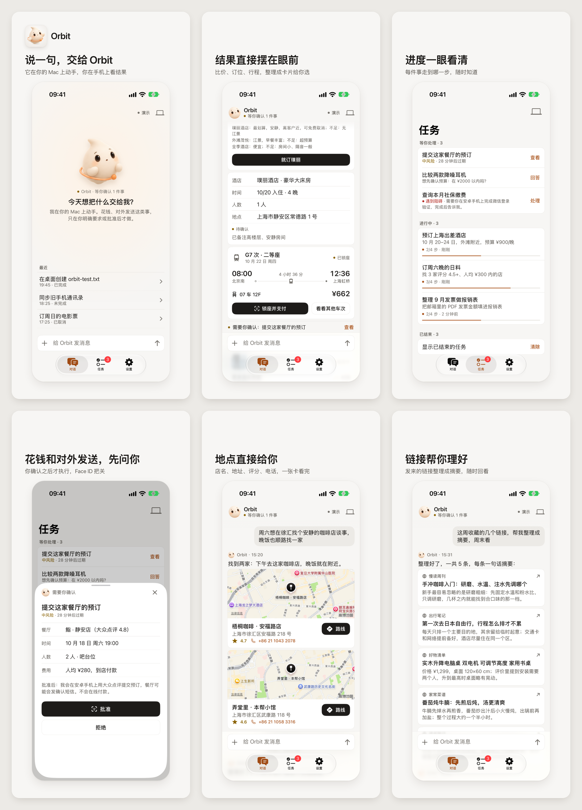
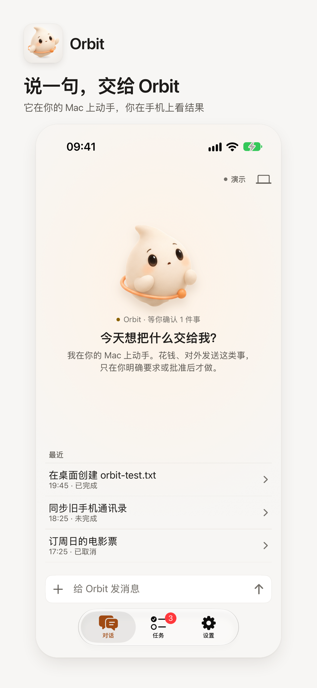
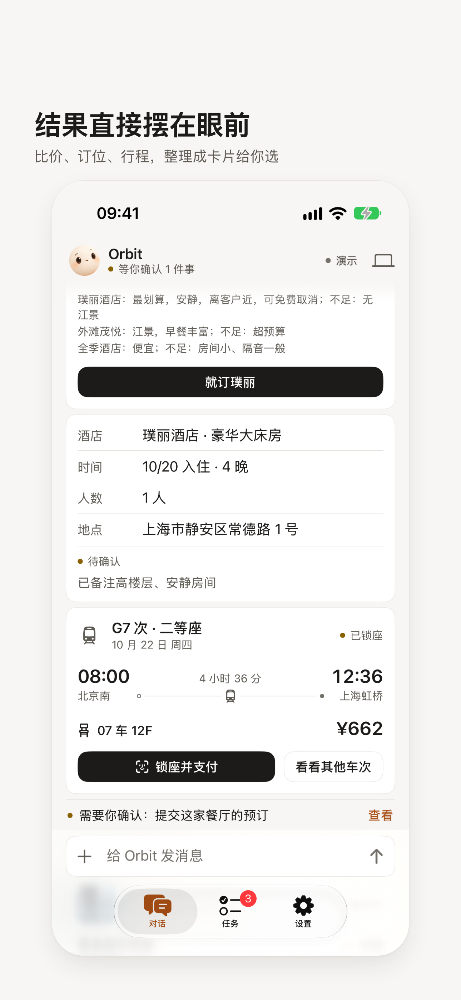
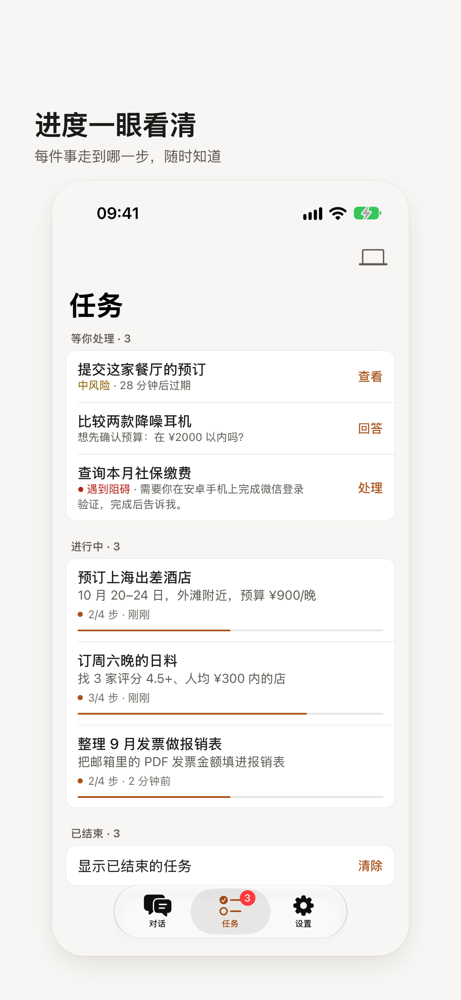
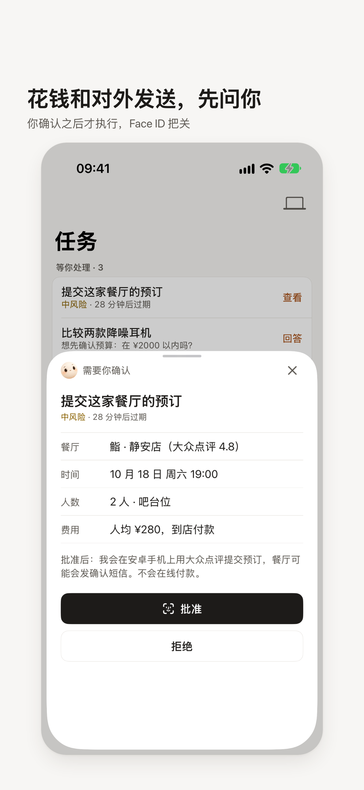
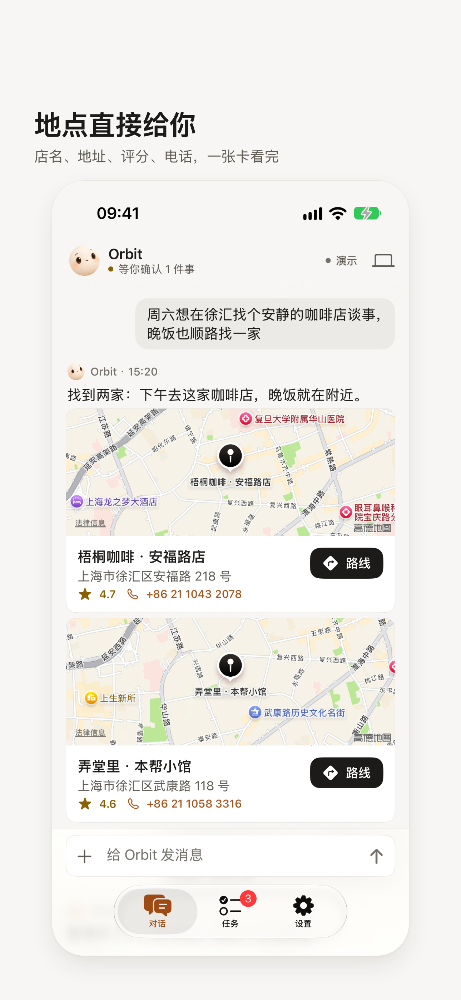
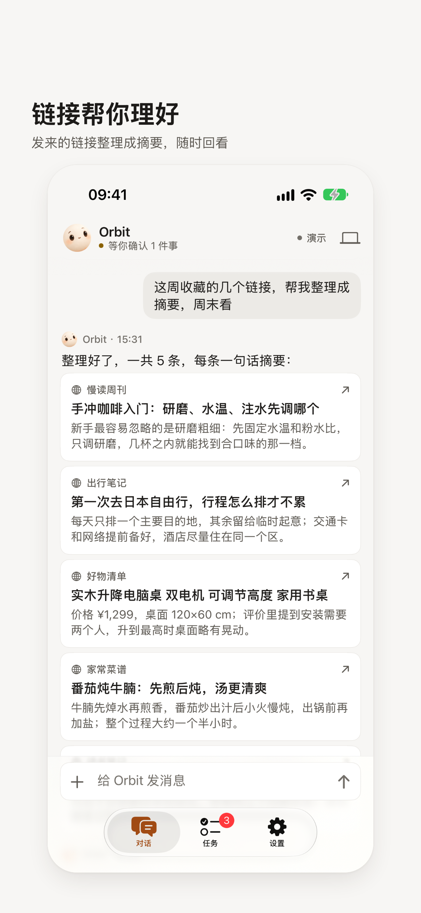
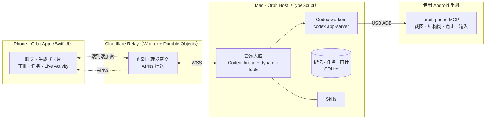

<div align="center">


# Orbit

[English](README.md) | **简体中文**

**住在你 Mac 上的私人管家：Codex 做大脑，专用安卓手机做手，iPhone 上和你说话。**


</div>

> [!WARNING]
> **这是一个实验性项目，实际使用大概率达不到你的预期。**
> 项目基本是 vibe coding 写出来的，有不少 bug，适合拿来研究和拆着玩，不建议托付重要的事情。

<p align="center">
  
</p>

## Orbit 是什么

Orbit 是一个自托管的私人管家，由四部分组成：

- **大脑**：在你的 Mac 上运行，基于 OpenAI Codex。
- **手**：一部专用安卓手机，通过 USB ADB 操作，去点外卖、查快递、订票、比价。
- **脸**：iPhone 上的 Orbit App，和你聊天、给你推送、请你审批。
- **中间**：一个 Cloudflare Relay，只转发加密后的消息。

它不是一问一答的聊天机器人。它会长期记住你的事，定时主动看一眼该关心的东西，手机来了重要通知会自己判断要不要告诉你，需要你拍板时才打扰你。

## 特点

### 站在 Codex 成熟的 agent 工程上

- **大脑**是一个长期运行的 Codex thread（`codex app-server` JSON-RPC）。管家的能力以 dynamic tools 的形式提供：任务、记忆、推送、审批、生成式卡片等。
- **复杂任务**派给独立的 Codex worker 会话：查资料、写代码、操作电脑、操作手机。它们可以并行，可以中断和取消，过程会留下审计记录。
- **计费**走你自己的 Codex（ChatGPT）额度，不需要单独申请 API Key。
- **技能**用 `skills/` 里的 Markdown 描述：行为准则、Codex 编排、生成式 UI、国内服务发现、记忆规则、手机操作规则。改一个文件就能改它的做事方式。

### 主动，而不是被动

- **心跳**：管家定时醒来，看看日程、待办和进行中的任务，有事才开口。心跳可以单独设置模型和推理强度。
- **手机通知唤醒**：专用手机收到新通知时，管家会看一眼再决定要不要告诉你、怎么说。广告和群聊刷屏直接忽略，验证码不会被转述。
- **APNs 推送分级**：只记录、静默、普通、时效性四级。每天有通知预算，还有静默时段，免得一天被打扰几十次。
- **Live Activity**：在锁屏和灵动岛上显示进行中的任务。

### 更像一个人

- **长期记忆**：有明确的记忆规则，记该记的，不乱记。
- **动态上下文**：空闲时自动压缩对话上下文，任务执行中不压缩，长期使用也不会越聊越慢、越聊越贵。
- **说人话**：界面上不显示「正在调用某某工具」这类技术细节，等待时只显示一个克制的打字动画。
- **生成式卡片**：地点、链接、图片、任务进度用卡片呈现，不是一大段文字。
- **知道分寸**：
  - 默认只查询。付款要你明确授权。
  - 登录、验证码、扫码、人脸交给你处理。
  - 敏感操作在 iPhone 上审批。
  - 任务可以随时打断。
- **懂国内生活**：内置美团、淘宝、京东、12306、高德等常用服务的选择方法。微信在专用手机上用不了，管家会找替代路线，实在不行交还给你。

### 隐私与安全

- **端到端加密**：iPhone 和 Mac 之间用 X25519、HKDF、ChaCha20-Poly1305 加密，配对时核对 SAS 短码，Relay 只能看到密文。
- **Host 身份**：用 Ed25519 鉴权，Relay 可以设白名单（`ALLOWED_HOST_IDS`）。
- **手机端**：截图里的密码页会被识别成敏感页面，结构树里的输入内容会脱敏，最终截图留证保存在本地。

## 效果图

<table>
  <tr>
    <td></td>
    <td></td>
    <td></td>
  </tr>
  <tr>
    <td></td>
    <td></td>
    <td></td>
  </tr>
</table>

## 架构



| 目录 | 内容 |
|---|---|
| [`host/`](host/README.zh-CN.md) | Mac 端 Host（TypeScript / Node）：管家大脑、Codex 编排、任务、记忆、心跳、推送、手机任务 |
| [`relay/`](relay/README.zh-CN.md) | Cloudflare Worker + Durable Objects：Host 鉴权、设备配对、转发密文、APNs |
| [`ios/`](ios/) | iPhone 客户端（SwiftUI，xcodegen 生成工程）：聊天、生成式卡片、审批、Live Activity、小组件 |
| [`phone/`](phone/) | `orbit_phone`：Android 自动化 MCP 服务（Python），0–999 坐标、截图、结构树、ADB Keyboard 输入、设备锁、留证 |
| [`skills/`](skills/README.zh-CN.md) | 管家技能：行为准则、Codex 编排、生成式 UI、国内服务、记忆规则、手机操作 |
| [`docs/`](docs/README.zh-CN.md) | 端到端加密协议、设计稿、效果图 |

## 部署

### 你需要准备

| 项 | 说明 |
|---|---|
| Mac | macOS，Node.js ≥ 22.13，Python ≥ 3.11 和 [uv](https://docs.astral.sh/uv/) |
| Codex | 安装 [Codex CLI](https://github.com/openai/codex) 并用 ChatGPT 账号登录（`codex login`） |
| Cloudflare 账号 | 用来部署 Relay，需要 Workers 和 Durable Objects |
| iPhone | iOS 18+，以及装有 Xcode 和 [xcodegen](https://github.com/yonaskolb/XcodeGen) 的 Mac |
| 专用 Android 手机 | Android 11+，打开 USB 调试，装好 [ADB Keyboard](https://github.com/senzhk/ADBKeyBoard)，Mac 上要有 adb（platform-tools）。小米 / HyperOS 还要打开「USB 调试（安全设置）」 |
| Apple 开发者账号（可选） | 推送通知需要。没有的话只能用免费账号自签，App 7 天过期，也收不到推送 |

### 0. 获取代码

```bash
git clone https://github.com/HerrysYu/orbit.git
cd orbit
```

### 1. 部署 Relay

```bash
cd relay
npm install
npx wrangler login
npx wrangler deploy        # 记下输出的 https://<name>.<subdomain>.workers.dev
```

- 打开 `relay/wrangler.toml`，把 `ALLOWED_HOST_IDS` 改成你自己 Host 的 hostId，或者留空表示不限制。改完后重新部署。
- 推送需要 APNs 密钥。在 Apple 开发者后台创建一个启用了 APNs 的 **Key**，下载 `.p8` 文件。注意要的是 `.p8` 密钥，不是 `.cer` 证书。然后执行：
  ```bash
  npx wrangler secret put APNS_KEY_P8    # 粘贴 .p8 文件的完整内容
  npx wrangler secret put APNS_KEY_ID    # 10 位 Key ID
  npx wrangler secret put APNS_TEAM_ID   # 10 位 Team ID
  ```
- 详细说明和排错见 [relay/README.md](relay/README.zh-CN.md)。

### 2. 启动 Mac 端 Host

```bash
cd host
npm install
npx tsx src/cli.ts config relay wss://<你的-worker>.workers.dev
npx tsx src/cli.ts install-skills     # 安装 skills/ 里的技能
npx tsx src/cli.ts start              # 启动管家
npx tsx src/cli.ts launchd            # 可选：生成登录自启的 LaunchAgent
```

### 3. 准备专用安卓手机

1. 手机用 USB 连上 Mac，在手机上信任这台电脑。
2. 运行：
   ```bash
   cd host
   npx tsx src/cli.ts phone setup        # 在 ../phone 里执行 uv sync
   npx tsx src/cli.ts phone status       # 检查 ADB 设备、输入法、安全调试设置
   ```
3. 默认只操作一台手机。连了多台时，用 `OPA_PHONE_SERIAL` 指定序列号。

更多选项见 [host/README.md](host/README.zh-CN.md)。

Host 还内置高德、12306、飞书、Playwright、网页读取、Tavily、GitHub 和 Notion 的 MCP 目录，按任务选择加载。用 `opa mcp list` 查看状态、`opa mcp init` 初始化本地配置；需要 Key 的服务另行填写凭据。参见[服务与 ModelScope 导入说明](docs/mcp-services.zh-CN.md)。

Gmail、Notion、Google Calendar 和 Google Drive 可复用 Codex 已连接的插件；Google Docs 由 Drive 的文档工具提供。管家先核实当前接口与权限，能用服务 MCP / 插件完成的步骤优先走接口，再考虑网页和电脑 / 手机界面。

App 聊天页右上角菜单可「清除聊天记录」，确认后同步清空聊天并重置当前对话；长期记忆、任务和配对信息保留。此功能需要新版 Host 和 App。

### 4. 安装 iPhone 客户端（自签）

```bash
brew install xcodegen
cd ios
xcodegen generate
open OPA.xcodeproj
```

- 先改 `ios/project.yml`：把 `DEVELOPMENT_TEAM` 改成你的 Team ID，`APP_BUNDLE_ID` 改成你自己的 Bundle ID，然后重新运行 `xcodegen generate`。
- 在 Xcode 里选中你的 iPhone，点 Run。第一次运行要在手机上信任开发者：设置 → 通用 → VPN 与设备管理。
- 推送要用 App 的 Bundle ID 作为 APNs topic，并且需要付费开发者账号。

### 5. 配对

```bash
cd host
npx tsx src/cli.ts pair       # 终端显示二维码
```

用 iPhone 上的 Orbit 扫码，核对两边显示的 SAS 短码一致后确认。之后就可以在 App 里和管家说话了。也可以用 `npx tsx src/cli.ts chat` 在终端里直接对话。

## 不足

坦白说，Orbit 现在还有很多不足：

- **平台**：
  - 电脑端只支持 macOS。
  - 专用手机只支持 Android。
  - 客户端只有 iOS。
- **Live Activity** 还有 bug，状态偶尔不同步。
- **推送通知**需要付费的 Apple 开发者账号，才能申请 APNs 密钥。
- **客户端**需要自己用 Xcode 签名安装。免费账号签的 App 7 天就过期。
- **大脑模型的 harness 写得不好**：工具设计、提示词和上下文组织都还很粗糙。
- **模型在 CLI 和 computer use 之间选路效率低**：明明一条命令能办的事，有时会去点界面，反过来也一样。
- **模型可能没有针对 phone use 做过 RL**：UI 操作效率低，一步一看、比较慢。手机任务也比较耗 Codex 额度。
- **微信**：专用安卓手机上用不了微信，微信里的小程序和公众号没有自动化通道。

## 联系与支持

- 邮箱：[herrys@another-startup.com](mailto:herrys@another-startup.com)
- 欢迎提 Issue 和 PR。这是个实验性项目，回复可能不及时。

如果这个项目帮到了你，可以考虑请我喝杯咖啡。

<p align="center">
  
</p>

## License

[MIT](LICENSE)
