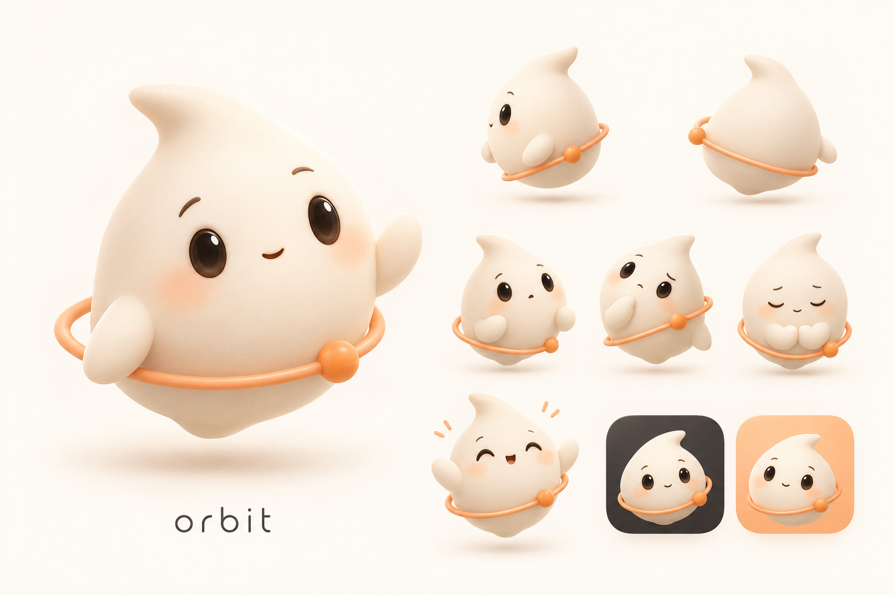

# Orbit App Design Brief and Claude Implementation Instructions

**English** | [简体中文](orbit-app-design.zh-CN.md)

Version: v1.0 · 2026-10-15  
Target platform: iPhone, native SwiftUI, project minimum iOS 18  
Deliverable type: Product interface and interaction requirements; this document does not mean the related UI, assets, or backend capabilities have all been implemented.

## 1. Understand the product first

Orbit is a personal agent that stays on the user’s Mac and works with the user through an iPhone. The user can give it a sentence, image, file, or link. Orbit breaks the request into tasks, uses tools, continues working, and comes back to ask the user when their input is needed.

The core experience is: **hand something to a reliable, lovable companion and always know what it is doing.**

The App must express two things at once: Orbit should feel approachable, while task status, authorizations, and delivered results remain clear, trustworthy, and under the user’s control.

Primary user journey:

1. Connect the user’s Mac.
2. Tell Orbit what to do.
3. See that the task has started and which step is in progress.
4. Add information or approve a specific action when needed.
5. Receive a result that can be viewed and used.

## 2. Visual reference and character lock

The image below is the primary visual reference for this design. Provide the original image to Claude as well. Some tools do not automatically read embedded Markdown images.

Reference file: `docs/design/orbit-mascot-concept-v1.png`. The original generation prompt is in `orbit-mascot-concept-v1.prompt.txt` in the same directory.

### 2.1 Character features that must remain

- A soft, slightly asymmetrical, cream-colored drop/mochi body, floating without legs.
- One small tuft leaning to one side on top of the head; do not turn it into two ears or a mechanical antenna.
- Dark-brown dot eyes, a small mouth, and restrained pale-peach blush.
- A pair of small fin-like hands and an alert, friendly expression.
- A thin apricot ring that slants around the body, with a clear front/back overlap.
- Exactly one small round satellite on the ring as a distinguishing feature.
- A gentle matte soft-silicone / soft-clay finish with warm lighting; do not use metal or strong specular reflections.

The character is provisionally called **Orbit 小星灵**; use Orbit as its display name and decide its Chinese nickname later. Grok bot and Muse are references only for “a character with personality that is easy to recognize and can express states”; the final appearance must follow this project’s concept image.

### 2.2 Derive the interface language from the character

- Cream body → warm light backgrounds and soft layers.
- Apricot ring → key actions, selected states, and small areas of emphasis.
- Dark-brown eyes → primary text and high-contrast action surfaces.
- Body silhouette → continuous corner radii, soft edges, and a few capsule components.
- Floating quality → light shadows and gentle hierarchy; do not make every control look like raised soft plastic.
- Satellite → subtle cues for state changes and progress; it cannot replace clear text.

**Use 3D only for character assets. Keep the main UI a clean, nearly flat native interface.** Do not turn every button, card, and icon into a 3D toy.

## 3. Overall art direction

Keywords: warm, soft, light, calm, slightly playful.

Leave plenty of open space and use clear text hierarchy. Build brand recognition mainly through color, character, rounded shapes, and details, not screen-filling decoration.

Visual priority: what needs attention now → main content and result → next action → companion atmosphere.

Avoid these directions:

- Sci-fi cockpit, blue-purple neon, a screen full of stars, glowing grids, and planet wallpaper.
- A giant mascot on every page or a full character repeated beside every message.
- Candy colors mixed together, children’s-game buttons, too many emojis, confetti, and badges.
- Putting everything in identical large rounded cards until the hierarchy becomes monotonous.
- Using cute copy to soften real consequences such as failure, cost, external sending, and deletion.
- Making the product look like a marketing landing page or drawing a fake phone frame around the UI.

## 4. Design tokens

These are first-version recommendations, not values sampled precisely from the concept image. Claude should use semantic tokens and verify text, icon, focus, and status contrast in the actual interface. Do not introduce ad hoc colors page by page.

### 4.1 Light mode

    {
      "canvas": "#FAF7F2",
      "surface": "#FFFFFF",
      "surfaceInset": "#F1EBE3",
      "ink": "#302B27",
      "inkSecondary": "#6D6259",
      "inkTertiary": "#7E7268",
      "hairline": "#DED5CA",
      "brandApricot": "#F2A15F",
      "brandSoft": "#FCE9D8",
      "accentText": "#8C471B",
      "primaryFill": "#302B27",
      "onPrimary": "#FFFDF9",
      "userBubble": "#FCE9D8",
      "onUserBubble": "#302B27",
      "success": "#326447",
      "successSoft": "#E9F2E9",
      "warning": "#875015",
      "warningSoft": "#FFF0D6",
      "danger": "#AC3932",
      "dangerSoft": "#FBE9E5",
      "link": "#8C471B"
    }

Apricot is the visual anchor. Use `accentText` for ordinary small text; do not put small white text on a light apricot background. Primary solid buttons use a dark-brown background with cream text; light-apricot buttons use dark-brown text. Always pair status color with an icon and text.

### 4.2 Dark mode

    {
      "canvas": "#191715",
      "surface": "#24211E",
      "surfaceInset": "#302B26",
      "ink": "#F6EFE6",
      "inkSecondary": "#C4B8AA",
      "inkTertiary": "#A99B8D",
      "hairline": "#51473E",
      "brandApricot": "#F2AD73",
      "brandSoft": "#453022",
      "accentText": "#F2AD73",
      "primaryFill": "#F2AD73",
      "onPrimary": "#241A13",
      "userBubble": "#453022",
      "onUserBubble": "#F6EFE6",
      "success": "#91C7A2",
      "successSoft": "#23362A",
      "warning": "#E7BA73",
      "warningSoft": "#3E301D",
      "danger": "#F39C91",
      "dangerSoft": "#412724",
      "link": "#F2AD73"
    }

Dark mode combines warm charcoal with cream. Keep the character cream-colored and blend it into the interface through a transparent background; do not paste a white-backed image as a bright rectangle.

### 4.3 Typography, sizing, and spacing

- Prefer iOS system fonts; use the system Chinese font for Chinese and let the system match English naturally.
- Welcome title: 28–32 pt, semibold, optionally rounded for selected text. Keep body text in the system’s default font design.
- Use the system title / largeTitle for page titles, headline for card titles, and body, subheadline, or footnote for supporting copy.
- Body text is about 17 pt; supporting information about 13–15 pt. Do not use tiny pale-gray text to make the interface look “refined.”
- Support Dynamic Type. Treat sizes as defaults and do not lock text-container heights.
- Default horizontal page margin: 20 pt, or 16 pt on small screens; main section spacing: 24–32 pt; component padding: 12–16 pt; related information: 4–8 pt.
- Reuse the project’s existing 4 pt rhythm. Existing 2 pt adjustments and 28 pt spacing may remain.
- Continuous card radius 22 pt; composer 20–24 pt; small components 12–14 pt. Do not add extra cards around ordinary settings rows.
- Buttons are usually 48–52 pt high; all tappable targets are at least 44 × 44 pt.
- Light cards may use at most one soft shadow. In dark mode, distinguish surfaces primarily by color. Do not use broad blur or gradients in body content.

## 5. Information architecture and navigation

Keep the existing three bottom destinations: **Chat / Tasks / Settings**. Before pairing, show the connection guide on first launch.

- Chat: express requests, add information, view replies and interactive cards; also the default home screen.
- Tasks: see ongoing work, things awaiting confirmation, and completed results together.
- Settings: manage Orbit, connections, memory, proactivity, notifications, and permissions.

Do not add separate “Home,” “Discover,” “Store,” “Achievements,” or “Character growth” destinations in the first release. Put memory and device management one level under Settings. Associate generated results with their task or conversation where possible.

Use native TabView and NavigationStack. The tab bar, composer, and sheets may use restrained system materials. Follow the capabilities of the target OS; do not require effects that only work on a new OS version.

## 6. Key screens

### 6.1 Welcome and Mac pairing

Purpose: explain how Orbit works and connect the phone to the Mac.

Place a waving character around 150–190 pt high near the top. Title: “你好，我是 Orbit”. Description: “连接你的 Mac，把想做的事交给我。” Add three short points explaining that work runs on the Mac, the user can check from the phone at any time, and the user confirms important actions.

Primary action: “连接我的 Mac”, followed by QR scanning. Offer “粘贴配对链接” as an alternative. If the existing demo mode is used, label it clearly as “体验演示” so it cannot look like a real device connection.

Support these states: camera not authorized, QR code invalid or expired, connecting, checking the verification code, connected, connection failed, and retry. The verification screen clearly shows the Mac name and six-digit code; the user can go back or cancel. If camera access is denied, provide the system Settings route and link pairing.

On success, the character waves briefly and the button says “开始和 Orbit 聊聊”. The success feedback can go straight to Chat without requiring a long tutorial.

### 6.2 Chat home: first use / empty state

Show Orbit’s name and a small avatar on the left of the top bar; show the Mac connection entry on the right. Keep a healthy connection understated; make offline status and issues needing attention more visible.

Place a 112–144 pt character in the upper-middle content area with “今天想把什么交给我？” and up to three short suggestions, such as “整理明天的日程”, “帮我比较几个方案”, and “总结这份文件”. Suggestions only fill a draft; the user sends it.

Keep the composer fixed above the keyboard and safe area. Default placeholder: “把想做的事交给 Orbit…”. Put the attachment entry on the left and Send on the right. Do not fill the first screen with feature cards.

### 6.3 Chat with existing messages

- Align user messages to the right, with a light-apricot bubble and dark-brown text; maximum width about 80% of the content area.
- Align Orbit replies to the left and prioritize clear body text, usually without a heavy frame. Show an avatar only at the start of a new reply group, not on consecutive replies.
- Expand timestamps, tool details, and debug information only when requested. The main view shows steps and conclusions that matter to the user.
- Long content supports paragraphs, lists, links, and necessary code blocks. Use suitable dedicated views for tables and files.
- While thinking, show a small character / simplified ring with “正在想办法…”. During execution, prefer a truthful action summary such as “正在整理文件”.
- Do not force-scroll when the user has moved away from the bottom. Show a “有新回复” entry for new streamed content. Follow new content only when the user was already at the bottom.
- Let the composer grow naturally to about six lines, then scroll internally. Attachments show a name/thumbnail, upload status, and remove button.
- While generating with no draft, the send position may become a Stop button. With a draft, allow the user to send an additional instruction. Clearly distinguish “stop the current reply” from “cancel the whole task.”
- Voice input is not confirmed as implemented. Do not put a nonfunctional microphone button in the first-release design; it may be an optional extension later.

When the keyboard appears, hide the large empty-state character and keep the composer and recent content. Important actions should be reachable one-handed.

### 6.4 Task list

Top title: “任务”, with the connection entry on the right. Show items needing confirmation first, then in-progress tasks, blocked tasks, and recently completed tasks.

Prefer organizing by sections. For many tasks, filters such as “进行中 / 已完成 / 全部” may be added. Filtering is a suggested UI capability; check that existing data supports it before implementation.

Each task item includes a title, status label, current-step summary, last-updated time, and step progress only when supported by actual data. An in-progress task may have a thin apricot marker on the left. Completed items are more compact and do not play ongoing celebration animation.

Do not show unsupported percentages or estimated completion times. If only step counts are available, say “已完成 2 / 4 步” and make clear that this is a step count. When progress cannot be quantified, show “进行中” and the current action.

The empty state uses an 80–100 pt character, text “这里会记录我替你做的事”, and action “去聊聊”. Once the list contains content, do not keep a character that occupies a large part of the screen.

### 6.5 Task details

Page hierarchy: task title and status → short goal → current progress / reason for waiting → step timeline → result → secondary actions.

Show steps as not started, in progress, completed, failed, or skipped; reveal more detail only when expanded. Emphasize the current step; do not animate every historical step at once.

Prefer usable result entries such as “查看文档”, “打开文件”, or “查看方案”. Put low-level logs and execution sessions under “执行详情”. Do not present download, share, pause, or retry controls as functional if they are not implemented.

Let the user return to the related conversation to add requirements. If the backend supports cancellation, provide a clear “取消任务” action and explain its state until the cancellation request is confirmed. Do not pretend the remote task has stopped immediately after a tap.

### 6.6 Actions that need confirmation

Use a stable, clear card or sheet. State what will happen, the object and scope, and any necessary consequences. For example, show recipient and message body when sending a message, or merchant, items, total, and currency when paying.

Use specific button verbs such as “批准发送”, “确认预订”, and “拒绝”; avoid generic “好的” or “继续”. Show an appropriate warning for irreversible or high-risk actions. Call biometric verification only according to the server’s `requireBiometric` value.

States include pending confirmation, submitting, approved, denied, expired, and submission failed. Prevent repeated taps while submitting and retain the content and error explanation after failure. Approval only means authorization succeeded; wait for the actual result before showing “已发送” or “已支付”.

Use at most a small avatar on an approval card. Do not use pleading or sad expressions to influence approval. Expired cards cannot be acted on. Sync approval results to Chat and Tasks; duplicate results must not open duplicate dialogs.

### 6.7 Generative UI cards

Reuse the project’s existing typed component directory. Components share a rhythm for title, content, metadata, and actions, but choose layouts appropriate to their content:

- Task progress: step summary and an entry to view details.
- Document / text: scannable title, summary, and open action.
- Calendar: date, time, location, and event list; do not imply that anything has already been written to the calendar.
- Comparison: emphasize differences and allow full content to be viewed. Use vertical items on narrow screens; avoid horizontal overflow across the page.
- Images: consistent-ratio thumbnails that open on tap; do not stretch the source image.
- Choice / form: make single-select, multi-select, and required fields clear; keep the user’s selections after submission.
- Orders / tickets / bookings: emphasize amount, time, object, and status; clearly distinguish draft, awaiting confirmation, and confirmed.

Update a card in place when its state changes instead of creating repeated copies of the same result. If a card update fails, preserve the last valid content and say it has not synced.

### 6.8 Settings and memory

Use a 64–80 pt character avatar and Orbit’s name at the top, followed by native grouped lists:

1. My Orbit: name, how to address the user, personality description.
2. Connection and devices: Mac name, connection status, paired devices, reconnect.
3. Memory: view, add, delete; distinguish what the user explicitly said from agent inference.
4. Proactivity and notifications: proactivity level, quiet hours, notification budget.
5. Permissions and privacy: approval mode, full access, device-context permissions.
6. Advanced settings: model and other technical configuration as needed.

First show ordinary users “how it helps me” and “what I control”. Put Host ID, Relay address, model identifier, and similar details under connection details or advanced settings. Describe the concrete impact of permissions; do not replace a full-access explanation with vague wording such as “smarter mode”.

Show saving, saved, or failed when a setting is saved. On sync failure, do not make a control look saved. For memory deletion, use a recovery or confirmation strategy supported by the existing interface; do not show an unsupported “Undo”.

### 6.9 Live Activity and Dynamic Island

Show task name, current step, status, and necessary action entry. In a compact area, use a simplified character header / ring mark; show a small character only in a larger area. Check clipping inside actual system containers.

When multiple tasks run in parallel, choose the one needing the most attention and provide an entry to the App for all tasks. When confirmation is needed, use text and a status symbol to direct the user into the App; do not rely only on changing the satellite’s color.

Follow system refresh and display rules. Static assets must communicate state too; do not make continuous 3D animation a dependency for the Lock Screen or Dynamic Island.

## 7. Mascot use and asset requirements

### 7.1 Recommended scale

- Onboarding: 150–190 pt; full character may be shown.
- Chat empty state: 112–144 pt; hide it when the keyboard appears.
- Task empty state: 80–100 pt.
- Settings header: 64–80 pt.
- Chat avatar: 28–32 pt; use a simplified avatar that keeps the eyes visible.
- Compact status: 16–24 pt; use a simplified ring / satellite symbol, not a scaled-down full 3D image.

Usually show only one primary character at a time. The mascot must not cover body text or controls, and must not act as an unexplained hidden button.

### 7.2 States and expressions

- Idle: calm smile, mostly static; one slight greeting motion when entering a page is allowed.
- Thinking: slightly tilted head and a restrained rotating ring; do not imply a percentage.
- Working: focused eyes; satellite indicates activity alongside truthful step text.
- Waiting for the user: look up and remain still, with a clear question or item needing confirmation.
- Complete: raise a small hand for one brief response, then return to calm.
- Failed / blocked: slight confusion but remain friendly; copy explains the actual reason and next step.
- Mac offline: calm pose plus explicit “Mac 暂时离线” text; do not imply rest only by closing the eyes.

Expressions are supporting information. Do not keep shaking the character or making it look toward the user’s finger while the user is reading for a long time.

### 7.3 Assets still to be produced

Only the concept image exists. **There are no transparent character cutouts or animation files ready for release.** The following filenames are asset-delivery suggestions and do not imply that the files already exist:

- `orbit-idle.png`: standard three-quarter view.
- `orbit-wave.png`: welcome wave.
- `orbit-thinking.png`: thinking.
- `orbit-working.png`: focused work.
- `orbit-waiting.png`: waiting for a response.
- `orbit-success.png`: complete.
- `orbit-trouble.png`: blocked.
- `orbit-avatar.png`: avatar composition.
- `orbit-mark.svg` or native vector: small ring mark.
- `orbit-app-icon.png`: standalone icon source without text.

Use transparent backgrounds, sRGB, consistent view and lighting, the same canvas ratio and visual center, with safe margins around the ring and waving arms. For example, use a 1024 × 1024 source canvas for character art, then export derivative sizes for each platform requirement. Make the App icon a separate, fully opaque background asset that follows the target platform’s specifications.

Do not use the full concept image as an avatar or treat a roughly cropped white-background image as a delivered transparent asset. If assets are missing, use the project’s existing mark and label the replacement point. If making a temporary placeholder, clearly distinguish it from final art.

## 8. Motion and haptics

Motion should explain response, spatial relationships, and state changes. Controls should not overshoot by default; use a little spring only when a gesture ends or the character makes a single expression.

- Give immediate press feedback with scale around 0.97; restore on release with a quick response around 0.15–0.18s.
- Small state changes take about 0.2–0.26s; card expansion, sheets, and layout changes take about 0.3–0.4s, preferably reusing existing Motion.
- Sheets follow gestures and can be interrupted or dragged back; do not block input until an animation finishes.
- On completion, briefly light the small satellite once; do not use full-screen confetti. A long task must not take over content the user is reading.
- Prioritize readable streaming text; do not fade in every character separately.
- Do not run permanent floating, breathing, or ring rotation by default except for necessary progress feedback. Stop decorative motion off-screen, in the background, or on low battery.
- Use haptics for submission, important status, or errors; avoid vibration for every token or step.
- Under Reduce Motion, remove rotation, translation, and bounce; use static states and about a 0.15s fade. Under Reduce Transparency, provide solid surfaces.

## 9. Real states and recovery experience

### 9.1 Mapping to the existing protocol

Use `docs/protocol.md` and the actual types as the source of truth. The design layer may change display copy but must not expand protocol enums on its own.

- `butler.status`: idle → idle, thinking → thinking, acting → acting, waiting → waiting.
- Task: planning → planning, running → in progress, `waiting_user` → needs more input, blocked → blocked, done → completed, failed → incomplete, cancelled → cancelled.
- Step: pending / running / done / failed / skipped map to not started / in progress / complete / failed / skipped.
- Session `waiting_approval` links to a specific Approval. A task waiting does not always mean approval; it may also be a clarification question.

Do not depict “thinking”, “waiting for approval”, “connecting”, and “Mac offline” as one endless spinner. Connection state, agent state, and task state come from separate sources. A Mac disconnect does not mean the remote task has stopped, and does not allow an in-progress task to be changed directly to failed.

### 9.2 Required exception cases

- Initial load: keep the page structure and load content locally; avoid a full-screen blank.
- Mac offline: say that work cannot run right now. If the message has entered the existing send queue, show “待发送”; otherwise retain the draft and explain.
- Reconnection: show recovery and last-updated time. After reconnecting, sync from server state without creating a duplicate task or sending duplicate approval.
- Send failure: retain message / draft and provide a clear retry. Distinguish queued, received by server, and actually completed.
- Blocked task: show the reason and what the user needs to do; do not invent an automatic recovery time.
- Expired approval: disable old buttons and explain. If needed, return to the task to view the latest request.
- Empty content, very long results, image load failure, and unsupported attachments all need understandable fallback content.

## 10. Accessibility and adaptation

- Ordinary text contrast must be at least 4.5:1. Validate large text and necessary control / status boundaries against their applicable standards. These colors have not yet had a complete audit in all actual combinations.
- VoiceOver must announce button meaning, connection status, task status, and progress. Hide purely decorative characters from the accessibility tree; if a character communicates state, its container supplies the state description.
- At large text sizes, cards grow, buttons stack vertically, and labels wrap. Never truncate approval objects, fees, or important action text.
- Do not communicate status by color alone; also provide text or symbols. Support increased contrast, reduced motion, and reduced transparency.
- Check safe areas and keyboard overlap on small, regular, and large iPhones and in landscape. On iPad, at minimum keep content width reasonable and the main flow usable.
- Markdown, filenames, long links, and mixed Chinese/English content must not break the layout. Horizontal scrolling is limited to components that genuinely need it.

## 11. Implementation with the existing project

Before design work or implementation, read project rules and handoff records (read `AGENT.md` completely if present), and inspect existing workspace changes. These existing paths are useful entry points:

- `ios/OPA/App/OPAApp.swift`: app entry, RootView, three tabs.
- `ios/OPA/Design/Theme.swift`: color references, Space, Radius, Motion, fonts, and shared components.
- `ios/OPA/Resources/Assets.xcassets/`: App semantic colors and icon assets.
- `ios/OPAWidgets/Assets.xcassets/`: Widget color assets; keep design semantics in sync.
- `ios/OPA/Features/Pairing/PairingView.swift`: connection and pairing.
- `ios/OPA/Features/Chat/ChatView.swift`, `ComposerView.swift`, `AttachmentTray.swift`: chat and composer.
- `ios/OPA/Features/Tasks/TasksView.swift`: task list and execution details entry.
- `ios/OPA/Features/GenUI/`: interactive cards.
- `ios/OPA/Features/Settings/SettingsView.swift`: settings, memory, and device pages.
- `ios/OPA/Core/Store/AppModel.swift`: state and action interfaces.
- `ios/OPAWidgets/OPAWidgets.swift`: Live Activity and Dynamic Island.
- `docs/protocol.md`: message, task, approval, and card schemas.

The existing theme uses indigo and a planet mark; this document proposes moving to a warm white / apricot character system. During migration, first preserve existing semantic token names and call sites; new roles such as brandApricot / `accentText` / onPrimary may be added, but map them consistently.

Pay special attention to hard-coded white foreground colors in old components. Do not replace the old dark AccentFill with light orange without also adjusting its text. Do not change encryption, connection behavior, task protocol, approval semantics, or persistence to reskin the UI.

Keep model settings, connection methods, and tool execution details in suitable settings / detail levels; do not remove existing capabilities for visual polish.

## 12. Claude delivery requirements and acceptance

Suggested order:

1. Read the project and character image; identify existing capabilities and differences from this document.
2. First deliver the four key screens: chat empty state, active chat, task list, and confirmation action. Lock the visual direction.
3. Extend pairing, task details, settings, memory, dark mode, and exceptional states.
4. If implementation is authorized, unify tokens and shared components, then implement page by page; do not default to replacing the whole project.
5. Verify with a real build, preview, or runtime environment, and record checks that were and were not run.

Design delivery must include at least:

- High-fidelity designs or previewable UI for key screens, with light / dark comparison.
- Page structure, user actions, state changes, and recovery paths.
- Token, component, and asset documentation; list existing and planned assets separately.
- Clear implementation scope, file changes, and capability gaps.
- Verification results for small screens, open keyboard, large text, offline, failure, and approval states.

Acceptance checklist:

- [ ] Orbit is recognizable from its colors and character even without reading the name.
- [ ] The three bottom destinations are clear; the default screen is ready to send a request.
- [ ] The character matches the reference, while body text and important actions remain easy to read.
- [ ] The user can tell whether they are connected, what the task is doing, and whether they need to participate.
- [ ] Sending, stopping a reply, and cancelling a task have distinct meanings.
- [ ] Approval object, real-world consequence, authorization result, and execution result are clearly distinguished.
- [ ] No fake progress, fake assets, inactive controls, or misleading completed state.
- [ ] Light orange does not cause low-contrast white text; dark mode has no white-backed asset blocks.
- [ ] Main paths work with large text, VoiceOver, and reduced motion.
- [ ] Existing capabilities, state interfaces, and uncommitted user changes are preserved.

## 13. Prompt to copy directly to Claude

    Please design the iPhone App for the Orbit personal agent according to docs/design/orbit-app-design.md.
    Also read docs/design/orbit-mascot-concept-v1.png; the character must follow that concept image.

    Orbit is a personal agent that interacts through a phone and performs tasks on the user’s Mac. Keep
    the project’s existing Chat / Tasks / Settings navigation and its pairing, approvals, generative cards,
    memory, and Live Activity capabilities.

    Visual direction: cream, apricot, and dark brown; a soft, cute 3D little star spirit paired with a clear,
    restrained native UI. Keep the small tuft, dot eyes, little fin-like hands, thin slanted apricot ring
    around the body, and single small satellite. Use the character for welcome, empty states, and key
    feedback; use a small avatar on content pages. Do not turn every control into 3D.

    First read project rules, handoff records, and the existing implementation, and inspect existing
    changes. Start with concrete designs for four key screens: chat empty state, active chat, task list,
    and action needing confirmation. Include components, tokens, real states, and dark-mode design,
    then extend to the other pages.
    Deliver design first; modify App code only if I explicitly ask for implementation.

    Do not add voice, pause, download, or character-growth features without supporting interfaces. Do not
    invent progress or success results. Clearly distinguish design proposals from capabilities that already
    exist. The character currently has only a concept image, with no transparent cutouts or animation
    assets; mark this asset gap and do not use the full concept image as an avatar or App icon.

    Follow the accessibility, keyboard, small-screen, offline-recovery, and approval requirements in this
    document. If implementing, reuse existing SwiftUI structures and semantic tokens; do not change the
    backend protocol, encryption, permission logic, or another agent’s changes.
    Deliver a reviewable result and report checks actually run and remaining work.
